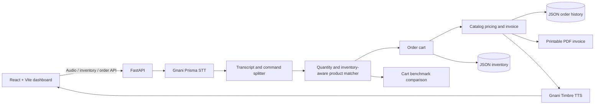

# Bharat Bazaar VoiceOS

**Voice-first order management for India's neighbourhood stores.**

Bharat Bazaar VoiceOS helps kirana retailers turn a spoken shopping list into a searchable order, priced invoice, stock update, and natural voice confirmation. The interface brings daily store operations—inventory, order history, analytics, evaluation, and a one-click demo—into one dashboard.

## Problem statement

Small retailers take many orders over calls and voice notes. Manually replaying audio, interpreting mixed Hindi and English, finding products, and calculating totals slows fulfillment and increases mistakes. VoiceOS automates that workflow while keeping the resulting cart and invoice visible for review.

## Features

- Upload WAV, MP3, M4A, or WEBM audio, or record an order using the browser microphone.
- Transcribe with Gnani Prisma STT; split multi-product speech and parse English and Hindi quantity words.
- Match pronunciation aliases in a 62-product, 14-category Indian kirana catalog.
- Review structured transcript, command timeline, cart, tax-inclusive invoice, and generated speech.
- Manage product details, prices, aliases, and stock from the inventory dashboard.
- Track orders, search or filter history, view saved invoice details, and download a printable PDF.
- Review daily/weekly order activity, product sales, revenue, and best-selling categories.
- Run the bundled audio benchmark or process a bundled sample in Demo Mode.
- Use the Admin page for quick access to store operations and the latest benchmark result.

## Architecture



### Main API routes

| Method | Route | Purpose |
| --- | --- | --- |
| `POST` | `/transcribe-order` | Existing upload/transcription workflow; response retains its original fields and adds order metadata. |
| `POST` | `/demo` | Process the bundled `order1.m4a` sample. |
| `POST` | `/evaluate` | Run all benchmark samples without saving orders or deducting stock. |
| `GET` | `/inventory` | Return products and low/out-of-stock counts. |
| `POST` | `/inventory` | Add a product. |
| `PUT` / `DELETE` | `/inventory/{product_id}` | Edit or remove a product. |
| `GET` | `/orders` | Search/filter order history. |
| `GET` | `/orders/{order_id}` | Fetch an order snapshot. |
| `GET` | `/orders/{order_id}/invoice.pdf` | Generate/download a printable PDF copy. |
| `GET` | `/analytics` | Return retailer sales metrics. |

Inventory and order history are stored as JSON under the ignored local `data/` directory. When first opened, inventory is seeded from `catalog/products.json` with 20 units per product. The JSON store is intended for a local demo or single-process installation; use a transactional database before running multiple API workers or serving concurrent stores.

## Price and tax behavior

Product prices are held as integer paise. Invoice line totals use the current inventory price. The sample invoice applies **5% GST as included in the catalog price**, so the grand total remains the advertised retail subtotal (for example, four Amul Butter at ₹58 and two Parle G at ₹10 total ₹252; ₹12 is shown as included GST). This is a demo assumption, not tax advice. Confirm product tax classifications and local tax rules before using invoices for real accounting.

## Tech stack

- Python, FastAPI, Pydantic
- Gnani Prisma STT and Gnani Timbre TTS
- RapidFuzz product matching
- JSON inventory and order-history persistence
- React 19, TypeScript, Vite
- pytest, browser-based UI checks, and an audio evaluation dataset

## Evaluation results

The current reported benchmark baseline is **9/9 exact cart matches (100%)**. Run the Evaluation page or use:

```bash
python scripts/evaluate_dataset.py
```

A live run calls the configured Gnani STT service for each recording. Benchmark processing does not synthesize confirmation audio, save customer orders, or update stock. The automated test suite covers parser behavior, inventory CRUD, pricing, confirmation copy, order history, analytics, PDF output, and workflow contracts.

### Dataset

| Recording | Scenario |
| --- | --- |
| `order1.m4a` | Multiple products and quantity correction |
| `order2.m4a` | Noodles, biscuits, and salt |
| `order3.m4a` | Dairy, biscuits, and flour |
| `correction_test.m4a` | Spoken correction |
| `correction_test_2.m4a` | “Actually” correction |
| `hindi_test.m4a` | Hindi quantity words and product names |
| `hinglish_test.m4a` | Mixed Hindi and English |
| `kirana_test.m4a` | Common store products and pronunciation variants |
| `noisy_test.m4a` | Recognition variation |

Ground truth is in `eval/ground_truth.json`; audio is in `samples/eval/`.

## Screenshots

The running app contains screenshot-ready Overview, Inventory, Orders, Analytics, Admin, Evaluation, and Demo pages. To capture current screenshots, start the frontend as described below and save browser captures in `docs/screenshots/`. Screenshots are not checked into this repository yet.

## Setup

### Requirements

- Python 3.11 or newer
- Node.js 20 or newer
- Gnani credentials and the Gnani Python SDK required by your account

Install backend packages in a virtual environment. This project currently has no Python dependency lockfile:

```bash
python -m venv .venv
# Activate the virtual environment for your shell, then:
python -m pip install fastapi "uvicorn[standard]" python-multipart python-dotenv rapidfuzz pytest
```

Install the Gnani SDK following the package and credential instructions provided for your Gnani account. Set `GNANI_API_KEY` in the environment or in `backend/.env`; never commit credentials.

### Start the API

Run from the repository root:

```bash
uvicorn backend.app.api.main:app --reload
```

The API is at `http://127.0.0.1:8000`; interactive docs are at `http://127.0.0.1:8000/docs`.

### Start the web app

In another terminal:

```bash
cd frontend
npm install
npm run dev
```

Open the Vite URL (normally `http://localhost:5173`). Set `VITE_API_BASE_URL` before starting Vite to use a different backend host; it defaults to `http://127.0.0.1:8000`.

### Tests and production build

From the repository root:

```bash
python -m pytest -q tests
cd frontend
npm run build
npm run lint
```

## Demo steps

1. Start the API and frontend.
2. Open **Demo mode** and select **Run the demo**; the bundled sample is transcribed and processed automatically.
3. Review the transcript, extracted commands, cart, invoice, and confirmation. Browser autoplay policies may require pressing Play.
4. Open **Inventory** to adjust price or stock, **Orders** to inspect the saved order and download its PDF, and **Analytics** to review sales.
5. Upload or record another voice order from **Overview**.
6. Open **Evaluation** and run the benchmark when Gnani credentials are available.

## Screenshots and release checklist

Before a public release, capture the live responsive pages into `docs/screenshots/`, verify credentials are managed outside source control, confirm store-specific GST rules, and replace the single-process JSON persistence with a transactional database.

## Future work

- Multi-store accounts, retailer authentication, and role-based permissions.
- Database-backed orders, inventory transactions, audit history, and backups.
- Configurable store identity, tax classifications, and invoice numbering.
- Reservation/fulfillment workflow and explicit low-stock order warnings.
- Larger regional-language and noisy-audio benchmarks with reproducible STT versions.
