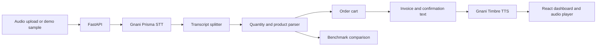

# Bharat Bazaar VoiceOS

VoiceOS turns a kirana customer's spoken shopping list into a structured order. It is designed to make voice ordering work with Indian products, Hindi and English quantity words, and the pronunciation variations common in speech recognition.

## Features

- Upload WAV, MP3, or M4A order recordings.
- Transcribe audio with Gnani Prisma STT.
- Split a multi-product transcript into commands and match products from a 60+ item kirana catalog.
- Review the parsed cart, generated invoice, and spoken order confirmation.
- Run the bundled audio benchmark and compare expected and actual carts.
- Run a bundled sample order in Demo Mode without choosing a file.
- Play confirmation audio generated by Gnani Timbre TTS.

## Architecture



The original `POST /transcribe-order` endpoint and its response fields remain available. Demo and benchmark workflows are exposed through additional `POST /demo` and `POST /evaluate` endpoints.

## Tech stack

- **API:** Python, FastAPI
- **Speech:** Gnani Prisma STT and Gnani Timbre TTS
- **Product matching:** RapidFuzz and `catalog/products.json`
- **Web app:** React, TypeScript, Vite
- **Testing:** pytest and the bundled audio evaluation dataset

## Evaluation

The current benchmark is reported at **9/9 samples passed (100% cart accuracy)**. The dashboard's Evaluation page runs the audio files through the configured speech service and calculates accuracy from exact cart matches. A live run requires valid Gnani credentials and can take time because each sample is transcribed.

The benchmark compares these samples:

| Sample | Focus |
| --- | --- |
| `order1.m4a` | Multiple products and quantity correction |
| `order2.m4a` | Noodles, biscuits, and salt |
| `order3.m4a` | Dairy, biscuits, and flour |
| `correction_test.m4a` | Spoken correction |
| `correction_test_2.m4a` | “Actually” correction |
| `hindi_test.m4a` | Hindi quantity words and product names |
| `hinglish_test.m4a` | Mixed Hindi and English |
| `kirana_test.m4a` | Common store products and pronunciation variants |
| `noisy_test.m4a` | Recognition variation |

Expected carts are stored in `eval/ground_truth.json`; audio files are in `samples/eval/`. Run the command-line benchmark from the repository root with:

```bash
python scripts/evaluate_dataset.py
```

## Screenshots

The app has three screenshot-ready views: Overview, Evaluation, and Demo Mode. Capture them from the running frontend and save them in `docs/screenshots/` when preparing a release or presentation. No benchmark or product screenshot is included in this repository yet.

## Run locally

### 1. Configure the speech service

Provide the Gnani API key as `GNANI_API_KEY` in the environment or in `backend/.env`. Do not commit credentials.

Install the Python packages used by the backend and the Gnani STT/TTS SDK in your active environment. (This repository does not currently include a Python dependency manifest.)

### 2. Start the API

From the repository root:

```bash
uvicorn backend.app.api.main:app --reload
```

The API is available at `http://127.0.0.1:8000`. FastAPI's interactive API documentation is at `http://127.0.0.1:8000/docs`.

### 3. Start the frontend

In another terminal:

```bash
cd frontend
npm install
npm run dev
```

Open the Vite URL shown in the terminal (normally `http://localhost:5173`). To use a different backend host, set `VITE_API_BASE_URL` before starting Vite; the default is `http://127.0.0.1:8000`.

### 4. Run tests

From the repository root, with the backend dependencies installed:

```bash
python -m pytest tests
```

## Future work

- Add a managed product catalog with retailer-specific pricing and stock.
- Persist orders and benchmark history.
- Add confidence review and manual cart edits before checkout.
- Expand the benchmark with more regional accents, product names, and noisy recordings.
- Add screenshots and a deployed demo environment.
