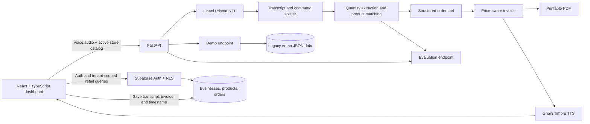

# Bharat Bazaar VoiceOS

> **The voice-first retail operating system for India's neighbourhood stores.**
>
> Turn a spoken kirana order into a structured cart, priced invoice, inventory update, order record, and natural voice confirmation.

[](https://www.python.org/)
[](https://fastapi.tiangolo.com/)
[](https://react.dev/)
[](#evaluation)

[Features](#features) · [Architecture](#architecture) · [Evaluation](#evaluation) · [Get started](#getting-started) · [Demo](#demo-workflow)

---

## Why VoiceOS

Kirana retailers receive orders in person, over calls, and through voice notes. Converting those conversations into accurate product lists and totals takes time, especially when customers switch between Hindi, Hinglish, and English or correct themselves mid-order.

Bharat Bazaar VoiceOS uses speech recognition and a retail-aware parsing workflow to transform those requests into reviewable store operations. Retailers can manage stock, keep order history, inspect sales analytics, and generate printable invoices from one dashboard.

## Features

### Voice ordering

- Upload an audio order or record one with a browser microphone.
- Transcribe with **Gnani Prisma STT**.
- Process Hindi, Hinglish, and English product requests.
- Split multi-product orders and extract spoken quantities.
- Match product names and pronunciation variants against the catalog.
- Handle spoken corrections before generating the final cart.
- Create natural-language confirmations and audio with **Gnani Timbre TTS**.

### Retail operations

- **Catalog and inventory:** add, edit, and remove products; manage categories, aliases, units, prices, and stock; review low-stock and out-of-stock counts.
- **Customers:** add, edit, delete, and search store customers by name or phone, scoped to the active business.
- **Orders:** completed voice and demo orders are persisted to Supabase with their business, transcript, invoice, and creation time; search history and inspect saved invoice details.
- **Invoices:** calculate price-aware line totals and review invoice details. The legacy shared PDF endpoint is disabled until tenant-scoped downloads are implemented.
- **Analytics:** review daily and weekly orders, items sold, average order size, revenue, and popular products and categories.
- **Admin:** access key store operations and benchmark results from a single page.
- **Tenant isolation:** retail accounts use Supabase Auth and business ownership enforced by database row-level security (RLS).
- **Demo mode:** process a bundled sample order without manually uploading audio.
- **Evaluation:** compare recognized carts against the bundled audio benchmark.

Before deploying tenant access, apply the SQL migration in [`supabase/migrations/`](./supabase/migrations/) to the Supabase project. Existing businesses have no owner assigned by the migration and must be explicitly mapped to verified accounts; see the [multi-tenant verification checklist](./docs/multi-tenant-verification.md).

## Architecture



### Technology

| Area | Technologies |
| --- | --- |
| Frontend | React, TypeScript, Vite |
| Backend | Python, FastAPI, Pydantic |
| Speech recognition | Gnani Prisma STT |
| Speech synthesis | Gnani Timbre TTS |
| Product matching | RapidFuzz and catalog aliases |
| Retail tenant data | Supabase Auth and Postgres RLS |
| Demo/evaluation fixtures | Local JSON files |
| Quality checks | pytest, TypeScript production build, Oxlint |

### API overview

| Method | Endpoint | Purpose |
| --- | --- | --- |
| `GET` | `/` | API health check |
| `POST` | `/transcribe-order` | Upload and process an audio order |
| `POST` | `/demo` | Process the bundled sample audio |
| `POST` | `/evaluate` | Run the bundled benchmark |
| `GET` / `POST` | `/inventory` | Disabled (HTTP 410); use the authenticated dashboard |
| `PUT` / `DELETE` | `/inventory/{product_id}` | Disabled (HTTP 410); use the authenticated dashboard |
| `GET` | `/orders` and `/orders/{order_id}` | Disabled (HTTP 410); use the authenticated dashboard |
| `GET` | `/orders/{order_id}/invoice.pdf` | Disabled (HTTP 410); no unscoped invoice downloads |
| `GET` | `/analytics` | Disabled (HTTP 410); use the authenticated dashboard |

Interactive API documentation is available at `/docs` when the backend is running.

## Screenshots

Screenshots are not checked into the repository yet. Capture the running app and add the images under `docs/screenshots/` before publishing:

| Suggested image | Screen |
| --- | --- |
| `docs/screenshots/overview.png` | Main dashboard and voice-order workflow |
| `docs/screenshots/inventory.png` | Product catalog and stock management |
| `docs/screenshots/orders.png` | Order history and invoice details |
| `docs/screenshots/analytics.png` | Retail sales analytics |

## Evaluation

The current benchmark result is **9 of 9 samples passed (100% accuracy)**.

| Metric | Result |
| --- | ---: |
| Samples | 9 |
| Passed | 9 |
| Failed | 0 |
| Cart accuracy | 100% |

The benchmark checks exact cart matches for English, Hindi, Hinglish, multi-product orders, pronunciation variants, and spoken corrections. Its audio samples are stored in `samples/eval/`; expected carts are in `eval/ground_truth.json`.

Run the evaluation from the repository root:

```bash
python scripts/evaluate_dataset.py
```

The evaluation page and `POST /evaluate` provide per-sample results. A live evaluation requires working Gnani STT credentials and access to the configured service. Benchmark processing does not save customer orders, deduct inventory, or generate TTS audio.

### Included samples

`order1.m4a`, `order2.m4a`, `order3.m4a`, `correction_test.m4a`, `correction_test_2.m4a`, `hindi_test.m4a`, `hinglish_test.m4a`, `kirana_test.m4a`, and `noisy_test.m4a`.

## Getting started

### Prerequisites

- Python 3.11 or newer
- Node.js 20 or newer and npm
- FFmpeg available on `PATH` to process browser-recorded WebM audio
- Gnani API access and the Gnani Python SDK for speech recognition and synthesis

The project does not currently include a Python dependency lockfile. Install the backend dependencies in a virtual environment and install/configure the Gnani SDK according to the instructions for your Gnani account.

### 1. Configure Gnani credentials

Copy the template and add your API key:

**macOS / Linux**

```bash
cp backend/.env.example backend/.env
```

**Windows PowerShell**

```powershell
Copy-Item backend/.env.example backend/.env
```

```dotenv
GNANI_API_KEY=your_api_key
```

Keep credentials private. Do not commit `.env` files or API keys.

### 2. Install backend dependencies

From the repository root:

```bash
python -m venv .venv
```

Activate the environment, then install the application dependencies:

**macOS / Linux**

```bash
source .venv/bin/activate
python -m pip install fastapi "uvicorn[standard]" python-multipart python-dotenv rapidfuzz pytest
```

**Windows PowerShell**

```powershell
.\.venv\Scripts\Activate.ps1
python -m pip install fastapi "uvicorn[standard]" python-multipart python-dotenv rapidfuzz pytest
```

Install the Gnani SDK using the distribution and setup instructions supplied for your account.

### 3. Install frontend dependencies

```bash
cd frontend
npm ci
```

The frontend uses `http://127.0.0.1:8000` as its default API URL. To use another backend address, set `VITE_API_BASE_URL` in the frontend environment before starting Vite:

```dotenv
VITE_API_BASE_URL=http://127.0.0.1:8000
```

### 4. Configure Supabase retail access

Create a Supabase project with email/password sign-in enabled, then apply all SQL migrations in `supabase/migrations/`. Phone OTP is hidden by default; enable it only after configuring the Supabase Phone provider, SMS delivery, and a verified phone identity linked to the account (`VITE_ENABLE_PHONE_OTP=true`). See the [auth and ownership setup guide](./docs/auth-ownership-setup.md). Set the project URL and publishable/anon key in `frontend/.env.local`:

```dotenv
VITE_SUPABASE_URL=https://your-project.supabase.co
VITE_SUPABASE_ANON_KEY=your-public-anon-key
```

Only the public anon key belongs in frontend configuration; never put a service-role key in the browser. The repair migration copies known legacy `owner_id` values. Designate a pilot administrator by setting server-managed `app_metadata.pilot_admin=true`; verified ownership repairs for remaining businesses are then performed in the app's Pilot Admin screen without per-business SQL.

## Running locally

Run each service in a separate terminal.

**Backend** — from the repository root, with the Python environment activated:

```bash
uvicorn backend.app.api.main:app --reload
```

The API is available at `http://127.0.0.1:8000`; interactive documentation is at `http://127.0.0.1:8000/docs`.

**Frontend** — from the `frontend/` directory:

```bash
npm run dev
```

Open the local URL printed by Vite (typically `http://localhost:5173`). Allow microphone access in the browser to use live recording.

### Run tests and checks

From the repository root:

```bash
python -m pytest -q
```

Then from `frontend/`:

```bash
npm run build
npm run lint
```

## Demo workflow

1. Configure the Gnani API key, then start the backend and frontend.
2. Open **Demo** in the application and choose **Run Demo**. VoiceOS loads the bundled `order1.m4a` sample automatically.
3. Review the recognized transcript, extracted commands, product quantities, cart, invoice, and generated confirmation.
4. Play the generated confirmation audio. Some browsers require a user gesture before audio playback.
5. Visit **Inventory** to review product stock and prices, **Orders** to inspect saved order details, or **Analytics** to view store metrics. Retail pages require a signed-in Supabase account.
6. Use **Overview** to upload or record another order, or open **Evaluation** to run the benchmark.

The demo requires working Gnani credentials because it performs live transcription and generates a voice confirmation.

## Project structure

```text
.
├── backend/
│   └── app/
│       ├── api/                 # FastAPI routes
│       └── services/            # Transcription workflow, parsing, inventory,
│                                # invoices, orders, analytics, evaluation, and PDF
├── backend/.env.example         # Local Gnani configuration template
├── catalog/
│   └── products.json            # Product catalog, prices, and matching aliases
├── data/                        # Local JSON inventory and order history (runtime)
├── docs/                        # Project documentation and screenshots (add captures here)
├── eval/
│   └── ground_truth.json        # Expected carts for evaluation samples
├── frontend/
│   └── src/
│       ├── components/          # Dashboard and retail pages
│       ├── api.ts               # Typed backend API client
│       └── App.tsx              # Application shell and navigation
├── samples/
│   └── eval/                    # Bundled benchmark audio
├── scripts/
│   └── evaluate_dataset.py      # Command-line benchmark runner
├── tests/                       # Backend service and API tests
└── tts_output/                  # Generated confirmation audio (runtime)
```

## Data, pricing, and deployment notes

- Inventory and order history are persisted as local JSON under `data/`. The first inventory load seeds products from `catalog/products.json` with 20 units of stock per product.
- JSON persistence is suitable for a local demo or a single-process setup. It is not a substitute for a transactional database when running multiple workers or serving multiple stores concurrently.
- Catalog prices are stored as integer paise. The sample invoice treats prices as tax-inclusive at a **5% demo GST rate**; for example, four Amul Butter at ₹58 each and two Parle G at ₹10 each total ₹252, with ₹12 shown as included GST. This is a demonstration assumption, not tax advice. Confirm applicable tax classifications and rules before using invoices for real accounting.
- The application is a working product prototype. Apply the Supabase migrations and perform the documented two-account ownership acceptance checks before production use.

## Future improvements

- Replace local JSON persistence with a transactional database, backups, and audit history.
- Configure store branding, tax rules, invoice numbering, and payment workflows.
- Add stock reservation, fulfillment tracking, and safeguards for insufficient inventory.
- Expand language coverage and benchmark size; measure accuracy across recording conditions and STT versions.
- Improve operational observability, deployment automation, and production monitoring.
